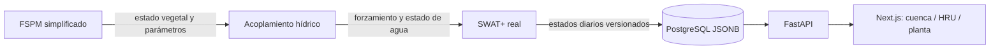

# From Plant to Watershed

Plataforma de software científico multiescala: **FastAPI + PostgreSQL + Next.js**,
un FSPM simplificado y ejecución real de SWAT+ sobre South Fork Iowa River
(`USGS 05451210`).

La [ficha técnica](project_framework.md) guía la investigación y la
[reformulación experimental](research_reformulation.md) delimita el primer
artículo, sus comparadores y la corrección ML. El alcance implementado y sus
pendientes se describen en [estado actual](docs/CURRENT_STATE.md); el
[índice técnico](docs/README.md) reúne los contratos y la evidencia.

## Qué funciona

- Ejecución SWAT+ en copias aisladas, preflight, normalización de inputs y
  trazabilidad por hashes, configuración efectiva y versión del código.
- [Motor de investigación desde fuente](docs/SWAT_SOURCE_BUILD_2019.md), con
  locks de compilación y salida independiente de almacenamiento fluvial.
- [Auditoría meteorológica y ET/PET](docs/METEOROLOGY_DIAGNOSTIC_2019.md), con
  procedencia gridMET, comparaciones externas y alertas del warm-up en pglocal.
- FSPM por calendario de siembra/cosecha ejecutado por SWAT+, con agregación
  ponderada y estimación de humedad radicular desde salidas diarias de HRU.
- Playback persistido como JSONB en PostgreSQL, consultable por fecha y resolución.
- Visor 3D de planta, campo y cuenca, con muestras modeladas y explorador de
  resultados HRU/canal. La geometría es contextual: falta la unión espacial
  verificada entre resultados y mallas.
- Catálogo de simulaciones, autenticación/RBAC, informes PDF/Word/Excel y
  diagnóstico interpretativo con LangChain o fallback heurístico.

## MVP demostrable

La corrida predeterminada del visor es **`phase234-sf-2019-v2`**, bundle diario
con checksums versionados para South Fork Iowa River. Contiene 365 fechas, 36
HRUs, 37 canales, 32 HRUs con calendario de maíz y estados de plantas FSPM
representativas durante 112 días. El acoplamiento registrado converge en dos
iteraciones; el cambio máximo final de `sw_ave` es 0,001 mm frente a una
tolerancia de 0,1 mm. `scripts/validate_phase234_bundle.py` comprueba estos
contratos antes de importar el bundle.



La interfaz consulta FastAPI para simulaciones, fechas y estados. La geometría
3D de cuenca es contextual; no existe una unión GIS validada que vincule cada
polígono visible con una HRU o canal concreto. Los resultados por HRU y canal
se seleccionan en el explorador del frame fechado.

La evaluación científica publicada más reciente es **`sf-test-v1`**, un
experimento separado de 2021–2025 con H1 no respaldada. No se deben presentar
sus métricas como una evaluación observacional de `phase234-sf-2019-v2`.
El bundle 2019 es una corrida operativa demostrativa, no una calibración ni una
prueba A/B contra observaciones.

La [entrega 5](docs/FUNCTIONAL_TWIN_DELIVERY_5.md) documenta el flujo y el
[manuscrito](research_domain/paper_v1/manuscript.md) reúne el primer borrador.
El ZIP del paper se descarga desde la aplicación y se regenera con la receta
de empaquetado; no incluye la base completa ni todos los inputs pesados de SWAT+.

## Instalación local

Requisitos: Python 3.12+, PostgreSQL, Node.js compatible con Next.js 16 y pnpm.
El frontend declara su versión de pnpm en `package.json` y usa `pnpm-lock.yaml`.
Los comandos siguientes parten de `from-plant-to-watershed/`.

### Inicio integrado con Docker Compose

Docker Compose levanta PostgreSQL, FastAPI y Next.js. La primera inicialización
debe preparar el catálogo de referencia e importar el bundle versionado:

```bash
cd from-plant-to-watershed
docker compose up --build --wait
docker compose exec -T backend python -m app.cli bootstrap-mvp
docker compose exec -T backend python scripts/validate_phase234_bundle.py
docker compose exec -T backend python scripts/register_phase234_south_fork_2019.py
docker compose exec -T backend python scripts/verify_phase234_postgres.py
```

El registro es idempotente y escribe los frames de playback en PostgreSQL. La
verificación consulta la API autenticada después de reiniciarla y falla si
detecta una lectura SQLite del playback. Escribe su ejemplo de respuesta en
`/tmp`, no dentro del bundle científico.

Abrir `http://localhost:3000/login` y entrar con `investigador@digitaltwin.org`
(`Investiga123!`, únicamente para desarrollo local). El visor abre
`/twin-3d?simId=phase234-sf-2019-v2`; también puede abrirse sin `simId` y elegirá
esa corrida si está disponible para el usuario. Cambiar la fecha, reproducir,
pausar, avanzar y retroceder conserva el mismo frame para cuenca, HRUs, canales
y estados FSPM.

La documentación OpenAPI está en `http://localhost:8000/api/v1/docs`. Para
detener los servicios conservando la base local, ejecutar `docker compose down`.
El Compose local deja desactivadas las fixtures simplificadas antiguas; el
comando `bootstrap-mvp` crea solo el catálogo local requerido para importar el
gemelo.

### Backend

```bash
cd backend
python -m venv .venv
source .venv/bin/activate
pip install -r requirements-dev.txt
cp .env.example .env
```

Configurar `backend/.env`:

```dotenv
APP_ENV=development
SECRET_KEY=una-clave-local-aleatoria-de-al-menos-32-caracteres
ENABLE_DEMO_SEED=false
DATABASE_URL=postgresql+asyncpg://digitaltwin@/digitaltwin?host=/run/postgresql&port=5432
```

La URL de ejemplo corresponde a la instancia PostgreSQL local por socket
`/run/postgresql`. Ajustarla a la instalación utilizada. No es necesario crear
otro clúster con `scripts/start_local_postgres.sh` para ese entorno.

La API inicializa tablas, migraciones SQL versionadas y roles. Una instalación
nueva puede crear su primer administrador mediante:

```bash
python -m app.cli create-admin --email admin@example.org --full-name "Administración inicial"
uvicorn app.main:app --reload --port 8000
```

`ENABLE_DEMO_SEED=true` habilita explícitamente fixtures legacy de desarrollo.
`python -m app.cli bootstrap-mvp` prepara datos demostrativos, pero no ejecuta
una validación científica ni sustituye la configuración de SWAT+.

Para habilitar el demo en una instalación local ya conectada a PostgreSQL:

```bash
python -m app.cli bootstrap-mvp
python scripts/validate_phase234_bundle.py
python scripts/register_phase234_south_fork_2019.py
uvicorn app.main:app --reload --port 8000
```

### Frontend

En otra terminal, desde `from-plant-to-watershed/`:

```bash
cd frontend
pnpm install --frozen-lockfile
pnpm dev
```

Abrir `http://localhost:3000`. Las rutas principales son `/simulations`,
`/twin-3d`, `/datasets` y `/reports`.

## Ejecutar SWAT+ real

El ejecutable y el proyecto de entrada deben estar disponibles localmente.
Configurar en `backend/.env`:

```dotenv
SWAT_PLUS_EXECUTABLE=/ruta/al/ejecutable/swatplus
SWAT_PLUS_PROJECT_DIR=/ruta/al/proyecto/TxtInOut
SWAT_PLUS_WORKING_DIRECTORY=data/swat-runs
SWAT_PLUS_TIMEOUT_SECONDS=3600
```

El proyecto necesita `file.cio` en su raíz o dentro de `TxtInOut/`. Crear la
simulación con `mode=SWAT_PLUS`, `hydrology_backend=SWAT_PLUS` y el `run_type`
`SWAT_STANDARD_BASELINE` o `SWAT_MULTISCALE_COUPLED` en `swat_plus`.
Las opciones por corrida incluyen periodo de calentamiento, frecuencia,
timeout y unidad outlet.

Antes de crear una corrida acoplada, `POST /api/v1/simulations/preflight`
comprueba cultivo activo, manejo, forcing y compatibilidad. La existencia de
una fila `corn` por sí sola no demuestra que las HRU cultiven maíz. South Fork
usa una variante experimental de manejo informada por CDL 2019.

Para retroalimentación hídrica usar salida `DAILY`. En frecuencias más gruesas
la trayectoria FSPM diaria conserva humedad asumida si no hay salidas HRU
diarias. Los fallos quedan como `FAILED`; no se sustituyen por hidrología proxy.
Detalles en [acoplamiento](docs/FSPM_SWAT_PLUS_COUPLING.md).

## Persistencia y playback

`playback_frames` guarda cada frame JSONB por `(simulation_id, resolution, date)`
con SHA-256. FastAPI lee PostgreSQL; los archivos SQLite comprimidos son
artefactos históricos de importación/recuperación. SQLite también se usa en
pruebas aisladas, no como runtime normal.

Los resultados versionados de South Fork 2019 están en
`backend/data/phase1-south-fork-2019/results/`. El script
`backend/scripts/register_phase234_south_fork_2019.py` valida checksums e
importa el bundle a PostgreSQL. Por defecto resuelve el usuario local
`investigador@digitaltwin.org`, la cuenca `USGS-05451210-PARTIAL` y el escenario
neutral `MVP_CONTROL`; no hace falta copiar UUID de PostgreSQL. Se pueden pasar
IDs explícitos para otro catálogo. El registro es idempotente para contenido
coincidente. Véase
[estado actual](docs/CURRENT_STATE.md).

Endpoints de playback principales (todos requieren autenticación):

| Ruta | Uso |
| --- | --- |
| `GET /api/v1/simulations` | Simulaciones accesibles para el usuario |
| `GET /api/v1/simulations/{id}` | Metadatos, configuración y procedencia |
| `GET /api/v1/simulations/{id}/availability?date=2019-07-15` | Rango, resolución y estado disponible para una fecha |
| `GET /api/v1/simulations/{id}/playback?resolution=DAILY&offset=0&limit=100` | Frames paginados desde PostgreSQL |
| `GET /api/v1/simulations/{id}/playback?date=2019-07-15` | Frame de una fecha |
| `GET /api/v1/simulations/{id}/playback?start=2019-07-01&end=2019-07-31` | Frames de un intervalo |

Cada frame incluye variables de cuenca y clima, estados por HRU, estados de
canal y muestras de planta con unidad, procedencia y disponibilidad. No hay un
endpoint de detalle separado por HRU: el cliente selecciona una HRU dentro del
frame que ya corresponde a la fecha elegida.

## Laboratorio ML externo

El [laboratorio Streamlit](../agro-digital-twin-st/README.md) exporta bundles
autocontenidos. El backend permite registrar bundles dentro de
`EXTERNAL_MODELS_DIR` mediante `POST /api/v1/models/register`.
Los bundles mensuales versionados son de desarrollo sintético; su desempeño
no es evidencia para H1.

## Verificación

```bash
cd backend
source .venv/bin/activate
pytest -q tests
```

Desde `frontend/`:

```bash
pnpm test
pnpm lint
pnpm exec tsc --noEmit
pnpm build
```

La suite backend configura una SQLite temporal propia. Las pruebas de motor
real requieren recursos SWAT+ explícitos; las comprobaciones específicas de
PostgreSQL usan scripts separados. Aprobar pruebas de software no equivale a
validar los resultados frente a observaciones.

### Métricas científicas reproducibles

El bundle 2019 no contiene observaciones emparejadas para calcular métricas
contra USGS. Para reproducir las métricas del experimento observacional
versionado `sf-test-v1` (TEST 2021–2025), ejecutar desde `backend/`:

```bash
python scripts/report_frozen_test_metrics.py
```

El comando verifica los SHA-256 publicados para observaciones, predicciones y
reporte; vuelve a calcular NSE, KGE, RMSE, MAE, PBIAS y R²; imprime periodo,
número de pares, dataset, corridas físicas de referencia y fecha UTC de la
reproducción. No vuelve a entrenar ni ejecuta SWAT+. Conserva el resultado
publicado `H1_NOT_SUPPORTED`; estas métricas no se transfieren a la corrida
`phase234-sf-2019-v2`.

```bash
docker compose exec -T backend pytest -q tests
docker compose exec -T backend python scripts/report_frozen_test_metrics.py
```
